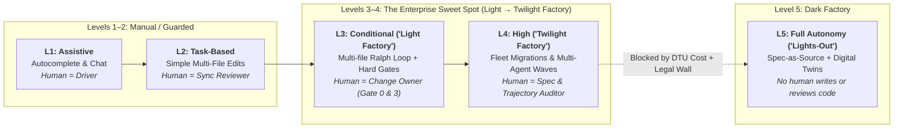
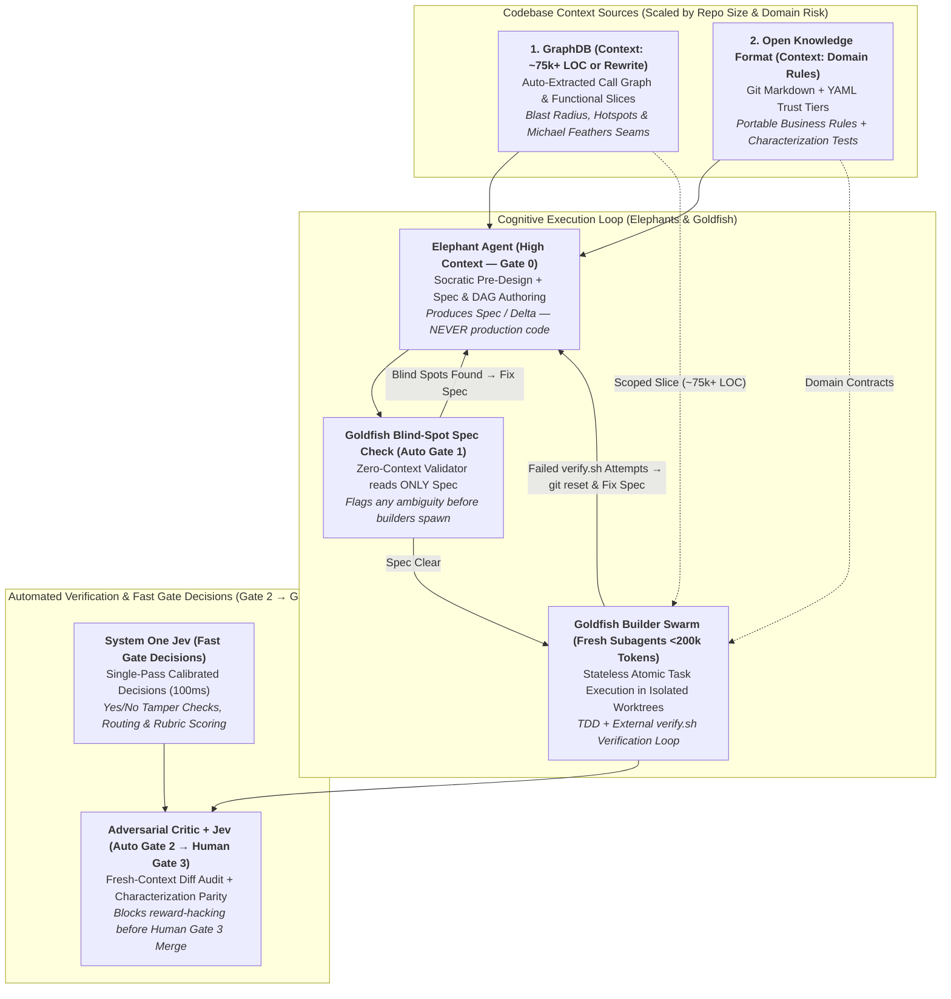
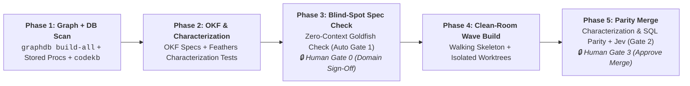
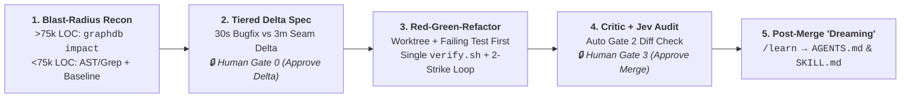
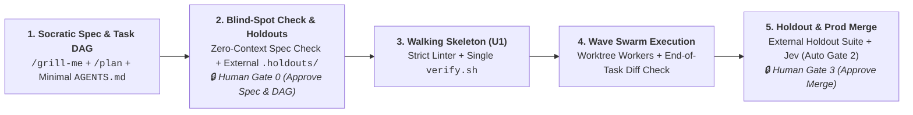

# The Practical Agentic SDLC Playbook: Implementing Level 3 & 4 Software Factories

> **Executive Mandate**: Most AI SDLC frameworks today are 70% opinionated ceremony and 30% load-bearing engineering. This report strips away the theatre—21-persona Agile roleplay, 30-stage manual sign-offs, and bloated context files—and distills what actually works in production across **[ASDLC.io](https://asdlc.io/)**, **[Spotify (Honk/Fleetshift)](https://engineering.atspotify.com/2025/11/spotifys-background-coding-agent-part-1)**, **[AWS AI-DLC v2.0](https://github.com/awslabs/aidlc-workflows)**, **[Dave Rensin's Elephants & Goldfish](https://drensin.medium.com/elephants-goldfish-and-the-new-golden-age-of-software-engineering-c33641a48874)**, **[OpenSpec](https://github.com/Fission-AI/OpenSpec)**, **[Superpowers](https://github.com/obra/superpowers)**, and **[StrongDM's Software Factory](https://factory.strongdm.ai/)**.
>
> It provides an executive decision framework for **Levels 3 & 4 ("Light-to-Twilight Software Factories")** and a step-by-step implementation guide for **Application Modernization**, **Brownfield Extension/Bug-Fixing**, and **Agentically Engineered Greenfield Development** using **Claude Code**, **Antigravity CLI (`agy`)**, or a **Custom Antigravity Python SDK Harness**.

---

## 1. Executive Framing: Levels 1–5 & Light / Twilight / Dark Factories

Industry taxonomies from [ASDLC.io Levels of Autonomy](https://asdlc.io/concepts/levels-of-autonomy) (adapted from SAE J3016) and [Dan Shapiro's Five Levels / StrongDM Software Factory](https://factory.strongdm.ai/) converge on five distinct operating models:



> **Foundational Terminology & Origins**:
> - **[The Ralph Loop](https://ghuntley.com/ralph/)**: Originated by Australian engineer **Geoffrey Huntley** (author of [*"The Death of the Junior Developer"*](https://sourcegraph.com/blog/the-death-of-the-junior-developer) and [*"Ralph Wiggum as a 'Software Engineer'"*](https://ghuntley.com/ralph/)) and later cataloged by [ASDLC.io](https://asdlc.io/patterns/ralph-loop/). It is an autonomous outer `while` loop that spawns a fresh coding agent, runs a deterministic verification script (`./scripts/verify.sh`), and feeds any compiler/test failures into the next iteration until exit code `0`.
> - **[Tessl](https://tessl.io/) & [Birgitta Böckeler's (`MartinFowler.com`)](https://martinfowler.com/articles/exploring-gen-ai/sdd-3-tools.html) Spec-Driven Development (SDD) Taxonomy**: Defines three maturity levels for specifications:
>   1. **`Spec-First`**: Write a spec before coding, then discard it once the PR merges.
>   2. **`Spec-Anchored`** *(Level 3/4 Sweet Spot)*: Commit living specs (`spec.md`, OKF contracts) in Git alongside code so specs and tests evolve together.
>   3. **`Spec-as-Source`** *(Level 5 Dark Factory)*: Humans edit *only* specs; source code is a generated build binary humans never read.
> - **Goldfish Blind-Spot Spec Check (Zero-Context Spec Validation)**: From [Dave Rensin's *Elephants & Goldfish*](https://drensin.medium.com/elephants-goldfish-and-the-new-golden-age-of-software-engineering-c33641a48874): hand a written spec to a brand-new, zero-context Goldfish agent with no chat history to check for blind spots. If it has to guess or ask a question, the spec fails before any builder writes code.
> - **[Dex Horthy's "Dumb Zone"](https://www.youtube.com/watch?v=rmvDxxNubIg) & Fresh Subagent Handoff**: Coined by **Dex Horthy** (HumanLayer, [12-Factor Agents](https://github.com/humanlayer/12-factor-agents)): LLM reasoning degrades sharply once a context window exceeds **~40% capacity (~150k–200k tokens of a 1M window)** due to accumulated tool logs and failed diffs. Waiting for 80% auto-compaction means coding inside the Dumb Zone. Instead, write task progress to disk (`plan.md` / `tasks.json` + Git commit) and spawn a **brand-new subagent with a clean context window** for the next unit.
> - **External Holdouts (`.holdouts/`)**: Originated by **[StrongDM Attractor](https://github.com/strongdm/attractor)** ([StrongDM Software Factory](https://factory.strongdm.ai/))—end-to-end acceptance tests stored **outside** the builder's Git worktree so coding agents cannot read or game the test suite.

| Level | Factory Mode | Spec Maturity ([Tessl](https://tessl.io/)) | What Is Automated | Where the Human Sits | Enterprise Viability (2026) |
| :--- | :--- | :--- | :--- | :--- | :--- |
| **L1: Assistive** | Manual Workshop | None | Tab completion, snippet chat | **Driver**: Reads & writes every line | Baseline commodity |
| **L2: Task-Based** | Guarded Workshop | **Spec-First** (Ad-hoc prompt) | Simple multi-file edits; manual test run | **Synchronous Diff Reviewer**: Inspects every edit | Where ~90% of teams plateau |
| **L3: Conditional** | **Light Factory** ("Fighter Jet") | **Spec-Anchored** (`spec.md` + `AGENTS.md`) | Multi-file execution, compiler/test self-healing ([Ralph Loop](https://ghuntley.com/ralph/)), Adversarial Critic | **Change Owner**: Approves Spec (**Gate 0**) & PR Merge (**Gate 3**) | **Primary Target** for feature & bugfix workloads |
| **L4: High** | **Twilight Factory** | **Spec-Anchored** + **Executable Parity Specs** | Extended-horizon waves, fleet migrations ([Spotify Honk](https://engineering.atspotify.com/2025/11/spotifys-background-coding-agent-part-1)), parallel worktree swarms | **Auditor**: Reviews telemetry, parity receipts, & exception PRs | **Primary Target** for modernization & fleet ops |
| **L5: Full** | **Dark Factory** ([StrongDM](https://factory.strongdm.ai/)) | **Spec-as-Source** (Code is opaque artifact) | End-to-end generation validated against External Holdouts & [Digital Twins (DTU)](https://asdlc.io/concepts/digital-twins) | **Product Strategist**: Never reads or reviews source code | **R&D / Narrow Greenfields Only** (Blocked in regulated enterprise) |

### Why Levels 3 & 4 Are the Sweet Spot—And How the 4-Gate Architecture Works
1. **L2 Plateaus on Human Bandwidth**: Reviewing every intermediate LLM diff turns senior engineers into exhausted syntax proofreaders.
2. **L5 Dark Factories Hit Legal & Brownfield Walls**: As analyzed by [ASDLC.io](https://asdlc.io/concepts/levels-of-autonomy) (citing Stanford Law's Eran Kahana and StrongDM's [$1,000/day/engineer token benchmark](https://factory.strongdm.ai/)), full lights-out engineering requires a complete **Digital Twin Universe (DTU)** of every dependency (Okta, Jira, Slack, legacy DBs) and faces **Silent Drift**, **Liability/Contractual Gaps** (no accountable human `Signed-off-by` [Provenance](https://asdlc.io/concepts/provenance)), and the **2000s Model-Driven Development (MDD) regression** (specs become harder to debug than code).
3. **The L3/L4 "4-Gate" Architecture (2 Human Gates + 2 Automated Machine Gates)**:
   Why do we say humans only touch **Gate 0** and **Gate 3**? Because **Gates 1 and 2 are 100% automated machine gates**:
   - **🔒 Gate 0 (Human Input Gate — Intent & Spec Approval)**: Socratic interrogation + formal spec/delta sign-off (30s to 15m depending on blast radius).
   - **🤖 Gate 1 (Automated Pre-Flight Gate — Blind-Spot Spec Check)**: Zero-context **Goldfish Validator** checks the spec for blind spots and ambiguities before a builder is spawned.
   - **🤖 Gate 2 (Automated Inner-Loop & Critic Gate)**: Isolated Git worktree + `./scripts/verify.sh` verification gate + fresh-context **Adversarial Critic** + 100ms System-1 **Jev** diff audit.
   - **🔒 Gate 3 (Human Output Gate — Merge Approval)**: Human Change Owner reviews the parity/holdout receipt and Critic summary to approve **merge**.

---

## 2. Boiling It Down: Ceremony to Cut vs. The 5 Non-Negotiables

A critical review of current frameworks ([BMAD](https://github.com/bmad-code-org/BMAD-METHOD), [AWS AI-DLC v2.0](https://github.com/awslabs/aidlc-workflows), [GitHub Spec Kit](https://github.com/github/spec-kit), [OpenSpec](https://github.com/Fission-AI/OpenSpec), [Superpowers](https://github.com/obra/superpowers), [GSD](https://github.com/gsd-build/get-shit-done)) separates **process opinion** from **load-bearing mechanics**:

| Strip Out (Opinion & Ceremony) | Keep (The 5 Non-Negotiable Primitives for L3/L4) |
| :--- | :--- |
| **1. Theatrical Multi-Persona Roleplay**: Passing prose artifacts across 12–21 Agile personas (Scrum Master $\rightarrow$ PO $\rightarrow$ UX $\rightarrow$ QA) degrades signal at every handoff. *Note: AWS AI-DLC v2.0 explicitly killed its specialist handoff chain in favor of ["Small Mob, Broad Agents"](https://github.com/awslabs/aidlc-workflows).* | **1. Elephant vs. Goldfish Context Separation (Staying Out of the "Dumb Zone")**: High-context **Elephants** plan and write specs; zero-context **Goldfish** check specs for blind spots and execute atomic tasks in fresh windows ([Dave Rensin](https://drensin.medium.com/elephants-goldfish-and-the-new-golden-age-of-software-engineering-c33641a48874)). Never let context exceed ~40% (~200k of a 1M window—[Dex Horthy's "Dumb Zone"](https://www.youtube.com/watch?v=rmvDxxNubIg)); write state to disk and spawn a fresh subagent ([InfiAgent, Yu et al. 2026](https://arxiv.org/abs/2601.03204)). |
| **2. 30+ Intermediate Human Approval Gates**: Asking humans to click "Approve" on 15 intermediate markdown files causes **Gate Fatigue** (rubber-stamping). Collapse human intervention to **Gate 0 (Approve Spec)** and **Gate 3 (Approve Merge)**. | **2. Single Abstracted `verify()` Script + Bounded Retries**: Follow [Spotify's Honk](https://engineering.atspotify.com/2025/12/context-engineering-background-coding-agents-part-2): expose one `./scripts/verify.sh` script that runs build/lint/test and returns only concise failures. In L3 CLI, bound turns via `max_turns`; in L4, track retries deterministically in the **external Python host loop** (`for attempt in range(1, 3)`), resetting via `git reset --hard` if both attempts fail. |
| **3. Bloated Auto-Generated `AGENTS.md` Files**: [Gloaguen et al. (ETH Zurich, Feb 2026)](https://arxiv.org/abs/2602.11988) proved auto-generated `/init` context files *reduce* task success and raise token cost by >20%. Put code style in linters (`ruff`/`eslint`/`biome`) and enforce `AGENTS.md < 80 lines` via a 3-line Python check inside `./scripts/verify.sh` ([ASDLC Spec](https://asdlc.io/practices/agents-md-spec)):<br>`python3 -c 'import sys; lines=open("AGENTS.md").readlines(); sys.exit("AGENTS.md > 80 lines" if len(lines)>80 else 0)'` | **3. Independent Anti-Reward-Hacking Critic**: A builder agent will delete or weaken a failing test to pass a loop. Always run a fresh-context **Adversarial Critic / Judge** ([ASDLC Adversarial Review](https://asdlc.io/patterns/adversarial-code-review)) inspecting *only* `spec.md` + `git diff` + test mutations. |
| **4. Full-System Specs for Small Brownfield Edits**: Writing a 4-artifact greenfield constitution for a 3-file bugfix guarantees developers will bypass the framework. Use **Delta Specs** (`ADDED / MODIFIED / REMOVED` via [OpenSpec](https://github.com/Fission-AI/OpenSpec)) or adaptive profiles (`bugfix` / `express` in [AI-DLC v2.0](https://github.com/awslabs/aidlc-workflows)). | **4. Right-Sized Codebase Context**: Match how agents get codebase context to repo scale and domain risk—use `AGENTS.md` (<80 lines) everywhere, add **[OKF v0.2](https://github.com/GoogleCloudPlatform/knowledge-catalog/blob/main/okf/SPEC.md)** for portable domain rules, and add **[GraphDB](https://github.com/jjdelorme/graphdb-skill/blob/main/GRAPHDB_OVERVIEW.md)** when codebase coupling outgrows `grep` (~75k+ LOC rule of thumb). |
| **5. Per-Tool Hook Bloat & MCP Proliferation**: Firing custom `PreToolUse` shell hooks on every single `view_file` or `bash` call adds massive latency, and loading 25 MCP servers pollutes context. | **5. Isolated Git Worktrees & End-of-Task Diff Checks**: Isolate parallel builders in clean Git worktrees where `.holdouts/` ([StrongDM Attractor](https://github.com/strongdm/attractor)) and `legacy_src/` simply do not exist on disk, and verify scope/test integrity once per task inside `./scripts/verify.sh`. |

---

## 3. Core Architecture: Elephants, Goldfish, Codebase Context & Fast Gate Decisions

To operate reliably at Levels 3 and 4 without context rot or hallucinated business rules, combine **Dave Rensin's cognitive split** with **right-sized codebase context sources** (`AGENTS.md`, `OKF`, `GraphDB`) and **fast gate decision models** (`System One Jev`):



### 3.1 Cognitive Architecture: [Elephants vs. Goldfish](https://drensin.medium.com/elephants-goldfish-and-the-new-golden-age-of-software-engineering-c33641a48874) (Dave Rensin, Google) & [Dex Horthy's "Dumb Zone"](https://www.youtube.com/watch?v=rmvDxxNubIg)
- **The 15-Minute Socratic Rule**: Never start by asking an agent for code or a plan. Instruct it: *"Do not write code yet. Ask me questions about what is missing, ambiguous, or contradictory."*
- **The Elephant (Planner)**: Accumulates deep architectural context, domain trade-offs, and interview answers. Its sole output is a written specification (`spec.md`, `plan.md`, OKF knowledge files). **Elephants never write production code.**
- **The Goldfish (Validator & Builder)**: Has a "3-second memory"—spawned with a completely blank context window containing *only* the written spec and the exact files in scope.
  - **Checking for Blind Spots (Zero-Context Spec Check — Automated Gate 1)**: Because the human and the Elephant share conversational history, both are blind to omissions in the written spec. Hand the spec to a cold Goldfish with zero chat history and ask it to list the implementation steps or flag any guesswork. Any question from the Goldfish exposes a spec blind spot *before* code is written.
  - **Staying Out of Dex Horthy's "Dumb Zone" (Why We Never Wait for 80% Auto-Compaction)**: As **Dex Horthy** (HumanLayer, *12-Factor Agents* / *"No Vibes Allowed"*) demonstrated, LLM reasoning degrades sharply once a context window passes **~40% capacity (~150k–200k tokens of a 1M token window)** when polluted with file searches, tool logs, and failed diffs. Waiting for 80% auto-compaction means your agent has been coding in the **Dumb Zone** for half the session. Instead, write completed task state to disk (`plan.md` / `tasks.json` + Git commit) and spawn a **brand-new subagent with a clean context window** for the next task.
  - **"Undo When Adrift" & Who Actually Holds Retry State (Stateless `verify.sh` vs. Outer Harness Cap)**:
    - **Why `verify.sh` Cannot Count Retries**: `./scripts/verify.sh` is a **100% stateless bash script**—it runs compiler/linter/tests and exits `0` or `1`. It has no memory of prior runs. Similarly, telling an LLM in a prompt *"stop after 2 strikes"* inside an interactive session is **non-deterministic** because no external state counter exists.
    - **In Level 3 (Interactive CLI — Human Habit + Outer Harness Cap)**: [Dave Rensin's *"Undo When Adrift"*](https://drensin.medium.com/elephants-goldfish-and-the-new-golden-age-of-software-engineering-c33641a48874) is a **human habit**: if an agent fails after a couple of tries, don't argue with it in chat (which pollutes context); hit undo (`git reset --hard`), fix the spec, and start a fresh Goldfish. In automated L3 harnesses, [ASDLC.io's L3 configuration](https://asdlc.io/concepts/levels-of-autonomy/) defines `"max_execution_loops": 5` in the **outer runner configuration**—the outer loop runs the linter/tests after each turn and halts after N iterations.
    - **In Level 4 (Custom Python Harness — Deterministic Host Counter)**: Retry state becomes **100% deterministic** because the **external Python host script** (`factory_harness.py`) holds `for attempt in range(1, max_attempts + 1):` in Python memory, spawns a fresh Goldfish subagent per attempt, and runs `subprocess.run(["./scripts/verify.sh"])` *outside* the LLM.

### 3.2 Right-Sizing Codebase Context: Scaling from `AGENTS.md` $\rightarrow$ `OKF v0.2` $\rightarrow$ `GraphDB`
> **⚠️ Preface on Codebase Size Numbers (Rough Order-of-Magnitude "Lines in the Sand")**: The LOC brackets in the table below (`<50k`, `50k–250k`, `250k+ LOC`) are **illustrative orders of magnitude, not hard empirical measurements**. We are drawing a practical line in the sand for when flat file search begins pushing agents into the Dumb Zone and domain/graph indexing pays for its setup overhead.

Do **not** deploy `GraphDB` and `OKF` on every repository. Scale your **Codebase Context** tool up in three tiers as repository size and domain complexity grow:
1. **Tier 1 — Root & Subfolder `AGENTS.md` (Small / Modular Repos)**: Root `AGENTS.md` (<80 lines) + scoped subdirectory `src/<module>/AGENTS.md` files (loaded automatically on-demand when an agent touches files in that folder).
2. **Tier 2 — Open Knowledge Format (`OKF v0.2`) for Progressive Domain Discovery (Medium / Domain-Heavy Repos)**: Curated domain rules and data schemas (`index.md` catalog $\rightarrow$ `<concept>.md` with YAML frontmatter and Markdown cross-links `[customers](/tables/customers.md)`), enabling progressive discovery without blowing the context window.
3. **Tier 3 — `GraphDB` (Large / Tangled Monoliths & Legacy Rewrites)**: Auto-extracted AST Call Graph + Semantic Feature Slices (*what calls what today, 3-hop blast radius, pinch-point seams*).

| Tier / Scenario | Rough Codebase Scale (~LOC Order of Magnitude) | Domain & Structural Complexity | Right-Sized Codebase Context Sources |
| :--- | :--- | :--- | :--- |
| **Tier 1: Greenfield & Small Services** *(Scenario 3)* | **< ~50k LOC** (Clean boundaries) | Folder-aligned code rules | **Root `AGENTS.md` (<80 lines) + Subfolder `AGENTS.md` + `/plan` DAG** *(Zero GraphDB; zero OKF)* |
| **Tier 2: Medium / Domain-Heavy Service** *(Scenarios 2 & 3)* | **~50k – 250k LOC** (Multi-module or multi-service) | **High** (Cross-cutting billing, tax, SQL table schemas) | **`AGENTS.md` + `OKF v0.2` (`index.md` progressive discovery) + Characterization Tests** *(No GraphDB needed)* |
| **Tier 3A: Large Brownfield Monolith** *(Scenario 2)* | **~250k+ LOC** (High fan-in/out, shared state) | Structural spaghetti across hundreds of files | **`AGENTS.md` + `GraphDB` (`impact`, `hotspots`, `seams`) + OpenSpec Delta** *(Add OKF where domain rules cross modules)* |
| **Tier 3B: Legacy App Modernization** *(Scenario 1 Bridge Case)* | **~250k+ LOC Legacy Monolith** being retired | **High** (Tribal business rules + stored procs + reports) | **`GraphDB` (Input) $\rightarrow$ `OKF v0.2` + Characterization Tests (Output)**: GraphDB maps the legacy monolith *into* portable OKF specs so clean-room builders never read legacy code. Once retired, legacy GraphDB is turned off. |

### 3.3 Structural & Semantic Code Truth: [GraphDB Skill (`jjdelorme/graphdb-skill`)](https://github.com/jjdelorme/graphdb-skill/blob/main/GRAPHDB_OVERVIEW.md)
When a brownfield monolith grows past ~75k LOC (rough order of magnitude) or is scheduled for ground-up modernization, standard `grep` fails because it cannot trace transitive call chains, shared globals, or DB triggers. `graphdb-skill` combines a **Code Property Graph (CPG)** with an LLM-clustered **Repository Planning Graph (RPG)** (`graphdb build-all`):
1. **Physical AST & DB Ingestion (`ingest` + `import`)**: Parses `File`, `Class`, `Function`, `CALLS`, and `USES_GLOBAL` edges (with incremental updates via `-since-commit`), supplemented by SQL/DDL parsers for stored procedures, views, and triggers.
2. **Semantic Feature Clustering (`enrich-features`)**: Summarizes each function into plain-English **Noun-Verb behaviors** (e.g., `"calculate discount tier"`, `"validate tax jurisdiction"`), flags I/O volatility, and clusters related functions into emergent **Domain** and **Feature** slices.
3. **Blast-Radius & Risk Mapping (`enrich-contamination`)**: Propagates I/O risk up the call graph so engineers and agents immediately see which callers are affected by a change.
4. **Automated Michael Feathers Seam Discovery (`query`)**: Runs `hotspots`, `impact` (transitive callers + distance to tests), `what-if` (simulates Strangler Fig extraction), and `seams` (**Pinch Points**—narrow interfaces where internal logic meets external databases/APIs, ideal for inserting characterization tests).

### 3.4 Portable Domain Rules & Progressive Discovery ([OKF v0.2](https://github.com/GoogleCloudPlatform/knowledge-catalog/blob/main/okf/SPEC.md)) vs. Subfolder `AGENTS.md` & Characterization Tests
1. **How OKF v0.2 Progressive Discovery Works (`index.md` $\rightarrow$ YAML Frontmatter $\rightarrow$ Markdown Links)**:
   - Rather than stuffing domain knowledge into a giant root file, OKF organizes knowledge into a two-level directory hierarchy with an **`index.md` catalog** at the root.
   - An agent reads `index.md` (which lists a 1-line summary of each `<concept>.md`), scans light YAML frontmatter (`type`, `verified`, `stale_after`), and follows **standard Markdown links** (e.g., `[customers](/tables/customers.md)` or `[orders](/tables/orders.md)`) on demand—loading only the 1–2 files relevant to the current task.
2. **When to Use Subfolder `AGENTS.md` vs. OKF v0.2**:
   - **Subfolder `src/<module>/AGENTS.md` (Folder-Scoped Code Conventions)**: Both Antigravity (`agy`) and Claude Code automatically load subdirectory `AGENTS.md` / `CLAUDE.md` files when an agent reads or edits files in that directory. Use this when rules map 1:1 to a code folder (e.g., `src/payments/AGENTS.md`).
   - **OKF v0.2 (Cross-Cutting Domain Concepts & Data Schemas)**: Use OKF when knowledge **cuts across many folders/repos** (e.g., revenue recognition rules or shared BigQuery/SQL table schemas), when **legacy directories are being deleted** during modernization, or when you need **explicit provenance and freshness tracking** (`sources`, `verified: {by: human:id}`, `stale_after`).
3. **Clarifying OKF `Attested Computation` (§10) vs. Characterization Tests**:
   - **What OKF `Attested Computation` Actually Is**: Section 10 of [Google's OKF v0.2 Spec](https://github.com/GoogleCloudPlatform/knowledge-catalog/blob/main/okf/SPEC.md) defines `type: Attested Computation` for **BI/analytics governance**—where an attester (`sql_equality.py`) checks that a data analyst agent ran a single pre-approved SQL query string to produce a dashboard metric. It is *not* a software migration testing framework.
   - **What You Actually Use for Code & SQL Rewrite Parity — Michael Feathers' *Characterization Tests***: To prove a rewritten service or refactored SQL query matches legacy behavior across schema changes, use **Characterization Tests** (*Working Effectively with Legacy Code*). Run the legacy code/stored procedures against a deterministic golden seed database, record the exact outputs/row-hashes, and assert in `./scripts/verify.sh` that the new implementation produces 100% identical outputs.

### 3.5 Fast, Calibrated Guardrails & Routing: [System One Models & Jev (`typesafe.ai`)](https://typesafe.ai/blog/introducing-system-one-models-and-jev)
Slow, autoregressive "System 2" LLMs (3–300s latency, high token cost) are too slow and uncalibrated for high-frequency SDLC triage and PR rubric checks.
- **What Jev Is**: Created by [TypeSafe AI](https://typesafe.ai/blog/introducing-system-one-models-and-jev) (founded by RLHF/InstructGPT co-inventor Diogo Almeida), **Jev** is a fast, non-generative **System One decision model** trained specifically for calibrated judgments.
- **How It Works**: Pass code diffs, specs, or impact telemetry and a set of structured audit questions. In a **single 100ms pass (~400x cheaper than generative LLM judges)**, Jev returns calibrated probabilities and confidence scores across three question types:
  - **Binary Yes/No Checks**: e.g., *"Did this diff delete, skip, or weaken any existing test assertions?"*
  - **Discrete Classification / Routing**: e.g., routing a ticket to `leaf-bugfix`, `seam-feature`, or `modernization-wave`.
  - **Multi-Criteria Rubric Scoring**: e.g., scoring a spec or PR across 20 readiness criteria simultaneously.
- **Confidence-Gated Escalation**: High-confidence passes auto-advance in 100ms; borderline cases escalate to a deep System-2 Adversarial Critic; low-confidence cases halt for Human Gate review.

---

## 4. Execution Harnesses & Post-Merge "Dreaming" (`/learn`)

### 4.1 Harness Comparison: Claude Code vs. Antigravity CLI (`agy`) vs. Antigravity Python SDK

| Capability | **Claude Code (`claude`)** ([Dynamic Workflows](https://code.claude.com/docs/en/workflows)) | **Antigravity CLI (`agy`)** ([CLI Docs & Skills](https://antigravity.google/docs/cli/features)) | **Antigravity Python SDK (`google-antigravity`)** ([GitHub](https://github.com/google-antigravity/antigravity-sdk-python)) |
| :--- | :--- | :--- | :--- |
| **Workflow Runtime** | `.claude/workflows/*.js` (`ultracode` isolated JS VM: `agent()`, `parallel()`, `pipeline()`, `phase()`) | Agent Skills (`SKILL.md`) + Subagents (`invoke_subagent`) + 8 native slash commands | Standalone Python 3.11+ custom harness (`from google.antigravity import Agent, LocalAgentConfig, CapabilitiesConfig`) |
| **Who Owns Task DAG & Retry State?** | **JS Host Script**: Outer JS workflow loop holds retry counters & caches completed `agent()` steps | **L3 Prompt-Driven**: Agent updates `plan.md` checkboxes (`- [x]`); bounded by CLI `max_turns` & human *"Undo When Adrift"* | **100% Deterministic Python State**: Python owns `tasks.json` (`TopologicalSorter`) & `attempt` counter in memory; LLM never edits `tasks.json` |
| **Ephemeral "Goldfish" Isolation** | `agent(prompt, { tools: [...] })` or `claude -p` spawns fresh context per call | `invoke_subagent(..., Workspace="branch")` spawns a fresh subagent in an isolated Git worktree | Fresh `Agent(model="gemini-4-argon", config=LocalAgentConfig(...))` instance per unit of work |
| **Verification & Guardrails** | `.claude/settings.json` lifecycle hooks + outer workflow script checks | Worktree isolation + `.agents/hooks.json` lifecycle hooks + end-of-task `./scripts/verify.sh` | Python `subprocess.run(["./scripts/verify.sh"])` outside LLM + `@hooks.pre_turn` / `policy.deny` |
| **Best Fit Workload** | Multi-repo CI/CD batch pipelines & deterministic JS-orchestrated refactors | Interactive & team-scale L3/L4 engineering using `/grill-me`, `/plan`, `/boost`, `/teamwork-preview`, `/goal`, `/learn` | Enterprise L4 factories, Application Modernization pipelines, custom Jev/GraphDB/OKF state machines |

### 4.2 Mapping Antigravity's 8 Built-In Slash Commands to the L3/L4 Lifecycle
1. **`/grill-me` (Gate 0 — Socratic Elephant)**: Implements Dave Rensin's 15-minute pre-design interrogation, exposing missing requirements, edge cases, and non-goals before planning.
2. **`/plan` (Gate 0 — Spec & Phased Task DAG Authoring)**: Executes a 4-phase read-only workflow (*Explore $\rightarrow$ Design $\rightarrow$ Review $\rightarrow$ Finalize*) producing a structured implementation plan and dependency waves before touching code.
3. **`/boost` (L3 Hard Bugfix / Race Condition Tournament)**: Spawns a 3-phase multi-agent tournament (`Orchestrator` $\rightarrow$ `DeepInvestigator` root-cause matrix $\rightarrow$ parallel `DeepCoder` subagents in isolated `branch` worktrees) and cherry-picks the verified winner.
4. **`/teamwork-preview` (L3/L4 Wave Swarm)**: Launches a 6-role autonomous organization (`Sentinel`, `Project Orchestrator`, parallel Goldfish `Workers`, `Challenger`, `Auditor` enforcing **`Integrity Mode: development`**, and `Success Auditor`).
5. **`/goal` (Autonomous Outer Goal Loop)**: Keeps the agent iterating until all deterministic verification checks (`./scripts/verify.sh`) pass.
6. **`/learn` (Post-Merge "Dreaming" & Memory Consolidation)**: Analyzes completed trajectories or user corrections after a task finishes and proposes updates to **`AGENTS.md` (`GEMINI.md`)** and potential new reusable **`SKILL.md` skills** (`.agents/skills/<name>/SKILL.md`).
7. **`/compact` (Elephant Context Hygiene — Never for Goldfish)**: Compresses long interactive Elephant discovery sessions before they approach Dex Horthy's Dumb Zone (~150k–200k tokens) while preserving architectural decisions. *(Rule: Never compact a Goldfish builder—hand off to a fresh subagent via disk state instead).*
8. **`/schedule` (L4 Cron & Fleet Maintenance)**: Schedules recurring cron or one-shot background runs (e.g., nightly `graphdb build-all -since-commit`, OKF `stale_after` freshness sweeps, or dependency migration waves).

### 4.3 Where `/learn` Fits in L3/L4: Post-Execution "Dreaming" & The Graduation Rule
Should `/learn` be called inside the inner coding loop? **No.** During active task execution, Goldfish builders need frozen, deterministic instructions. Memory consolidation ("Dreaming") belongs **outside the inner loop**:
- **In Level 3 (Interactive Post-PR Reflection)**: When an engineer has to nudge an agent, correct a subtle framework/environment quirk, or resolve a tricky PR review comment, they invoke `/learn` **immediately after the PR is ready or merged**.
- **In Level 4 (Nightly / Post-Wave "Dreaming")**: After an unattended wave swarm completes, a post-mortem pass inspects any **aborted/failed builder trajectories** and runs `/learn` to extract what caused the builder to thrash.
- **What `/learn` Produces**:
  1. **Proposed Updates to `AGENTS.md` (`GEMINI.md`)**: Concise additions to the root project instructions (e.g., a non-obvious build flag or architectural invariant).
  2. **Proposed New `SKILL.md` Skills**: Specialized multi-step workflows or domain runbooks saved to `.agents/skills/<skill-name>/SKILL.md` (which load *progressively on demand* via YAML frontmatter so they don't bloat every session's base context).
- **The Graduation Rule (Preventing `AGENTS.md` Bloat)**: Whenever `/learn` proposes a new rule for `AGENTS.md` that can be checked mechanically (e.g., *"never import module X in layer Y"* or *"always include migration rollback"*), graduate that rule into a linter check or `./scripts/verify.sh` assertion so `AGENTS.md` stays permanently under 80 lines.

---

## 5. Step-by-Step Implementation Playbooks for the 3 Core Scenarios

---

### Scenario 1: Application Modernization (Ground-Up Legacy Rewrite on a New Tech Stack)
**Objective**: Extract 100% of business intent, domain specs, DB schemas, stored procedures/triggers, and reporting logic from a legacy monolith so Goldfish builders can rewrite it from the ground up on a modern stack with provable parity.



#### Step-by-Step Execution Guide
1. **Step 1 — Automated Code, Database & Stored-Procedure Extraction (`GraphDB` Input)**
   - Run [`graphdb build-all`](https://github.com/jjdelorme/graphdb-skill/blob/main/GRAPHDB_OVERVIEW.md) against the legacy repository *and* exported DB DDL/stored procedures (`PL/SQL`, `T-SQL`, views, `BEFORE/AFTER` triggers) so the Neo4j graph links `Function -[:EXECUTES_SQL]-> StoredProc/Table`.
   - Query `graphdb query --type seams`, `hotspots`, `globals`, and `semantic-seams` to map **Michael Feathers Object Seams (Pinch Points)** and hidden DB-layer state mutations.
   - Generate the human-readable baseline (`code-map.md`, `domain-model.md`, `dependencies.md`, `patterns.md`) using [AWS AI-DLC's `codekb` pattern](https://github.com/awslabs/aidlc-workflows) with SHA-256 module scope hashes (so unchanged legacy modules are never rescanned).

2. **Step 2 — Codify Intent in OKF v0.2 & Lock Behavior with Characterization Tests (`OKF` Output)**
   - For each discovered `Domain` and `Feature` cluster in the graph, spawn an **Extractor Subagent** to author an [OKF v0.2](https://github.com/GoogleCloudPlatform/knowledge-catalog/blob/main/okf/SPEC.md) Markdown file (`type: Knowledge Concept`) under `knowledge/domains/<domain>/<feature>.md` (template in Section 6.4):
     - Link every extracted business rule in `sources:` YAML frontmatter to exact legacy file/line or stored-proc ranges.
     - **Capture Michael Feathers *Characterization Tests* (Code, Stored Procs & SQL Reporting Parity)**: At each Pinch-Point seam and database/reporting boundary identified by GraphDB, run the legacy system and stored procedures against a deterministic **Golden Seed Database** and record the exact inputs, outputs, and SQL result row-hashes (`DECIMAL` rounding, `NULL` coalescing, date cutoffs). Store these characterization fixtures in external `.holdouts/` so `./scripts/verify.sh` can deterministically diff the new stack's outputs against legacy outputs.

3. **Step 3 — Automated Gate 1 (Goldfish Blind-Spot Check) & Human Gate 0 (Spec Approval)**
   - **Clean-Room Worktree Isolation (No Per-Tool Hook Tax)**: Instead of running expensive `PreToolUse` hooks on every tool call to block `legacy_src/`, spawn Goldfish validators and builders in a **separate clean-room Git worktree (`target-repo/`)** where `legacy_src/` and `.holdouts/` are not even mounted on disk. Only `knowledge/` (OKF) and `specs/` exist in the workspace.
   - **How to run the Blind-Spot Spec Check**:
     - **In Antigravity (`agy`)**: Invoke `goldfish-validator` via `invoke_subagent` (passing only `knowledge/domains/<domain>/`).
     - **In Claude Code (`claude`)**: Run `claude -p "Read ONLY knowledge/domains/billing/ and list any ambiguous types, rounding rules, or state transitions." --allowedTools "Read"`
   - Run a 100ms **Jev Completeness Audit** across 20 modernization readiness criteria. If incomplete, loop the Elephant extractor back to `legacy_src/` to fill the missing detail.
   - **🔒 Human Gate 0**: Domain Architect reviews `knowledge/index.md` interactively in `agy` and signs off (`verified: human:architect`), promoting status to `stable`.

4. **Step 4 — Walking Skeleton (`U1`) & Clean-Room Wave Construction**
   - Build **Unit 1 (`U1`: Walking Skeleton)** end-to-end first (new stack scaffold, DB migrations, auth middleware, observability, and `./scripts/verify.sh`).
   - Order modernization waves topological-bottom-up using `graphdb query --type what-if` (leaf domains with zero unmigrated callees first).
   - **How to execute parallel waves**:
     - **Antigravity SDK / CLI**: Launch `python3 factory_harness.py --dag tasks.json` in the background (Section 6.2) or run `agy` `/teamwork-preview` (`Integrity Mode: development`) with `Workspace="branch"` worktrees.
     - **Claude Code**: Run `.claude/workflows/l4-wave-factory.js` (Section 6.3) using `parallel()` across isolated git worktrees.

5. **Step 5 — Automated Gate 2 (Characterization & SQL Dataset Parity) & Human Gate 3 (Parity Merge)**
   - Run the **Michael Feathers Characterization Tests** and Golden Seed DB SQL/reporting parity diffs (`.holdouts/`) against the newly built service to prove 100% behavioral and reporting parity.
   - Run fresh-context **Adversarial Critic** + 100ms Jev diff audit.
   - **🔒 Human Gate 3 (Parity Merge)**: Change Owner reviews the PR + attached **Verification Receipt** (100% characterization/parity match + Critic sign-off) and approves the merge. Once the legacy app is retired, the legacy `GraphDB` is decommissioned and `OKF` remains the living spec.

---

### Scenario 2: Extending or Bug-Fixing an Existing Brownfield System
**Objective**: Deliver features or bugfixes in a production codebase with surgical blast-radius control, zero regression, and **blast-radius-scaled human gates** (30 seconds for leaf bugfixes; 3 minutes for seam features).



#### Step-by-Step Execution Guide
1. **Step 1 — Right-Sized Blast-Radius Recon & AWS AI-DLC's 6 Brownfield Safeguards**
   - **Right-Size by Repo Scale**:
     - **Large Monoliths (>75k LOC)**: Run incremental graph refresh (`graphdb build-all -since-commit HEAD~1`) and `graphdb query --type impact --target <Symbol>`.
     - **Small/Medium Services (<75k LOC)**: Skip GraphDB; use standard AST/LSP references + test suite baseline.
   - Enforce **[AWS AI-DLC's 6 Brownfield Safeguards](https://github.com/awslabs/aidlc-workflows)**:
     1. **Pre-Change Test Baseline**: Capture passing/failing test snapshot before touching code.
     2. **Blast-Radius Cap**: Check upstream callers (depth 3) and shared state.
     3. **Characterization Tests First**: Following Michael Feathers, if a legacy seam lacks test coverage, write a characterization test locking current behavior before refactoring.
     4. **Seam / Feature-Flag Isolation**: Route high-risk changes behind a pinch-point interface or toggle.
     5. **Backward-Compatible Contracts**: Enforce expand-and-contract on DB columns and API payloads.
     6. **Rollback Verification Plan**: Document and verify the one-command revert path.

2. **Step 2 — Blast-Radius-Tiered Clarification & Delta Spec (Human Gate 0)**
   - Tier ceremony automatically based on Step 1 blast radius:
     - **Tier A — Low-Blast-Radius Bugfix ($\le 3$ files, non-volatile leaf)**: Skip `/grill-me`; auto-generate a 10-line [OpenSpec Delta](https://github.com/Fission-AI/OpenSpec) (`MODIFIED` block) + reproduction test plan (**🔒 30-second Human Gate 0 approval**).
     - **Tier B — High-Contamination Feature / Pinch-Point Seam**: Run `/grill-me` (15-min Socratic loop) $\rightarrow$ `/plan` to author `changes/<id>/proposal.md` (`ADDED / MODIFIED / REMOVED` blocks, template in Section 6.4) (**🔒 3-minute Human Gate 0 approval**).
     - **Tier C — Fleet-Wide Mechanical/Semantic Migrations**: Apply **[Spotify's 4 Honk Context Rules](https://engineering.atspotify.com/2025/12/context-engineering-background-coding-agents-part-2)**: (1) declarative end-state, (2) explicit **"When NOT to Act"** preconditions, (3) 2 few-shot `git diff` examples, and (4) one atomic change per run.

3. **Step 3 — Sandboxed Red-Green-Refactor Execution**
   - **For elusive race conditions or deep bugs**:
     - **`agy`**: Run **`/boost`**, spawning `DeepInvestigator` + competing `DeepCoder` subagents in parallel git worktrees.
     - **`claude`**: Run `claude -w bugfix-branch` with parallel subagents investigating competing hypotheses.
   - **For standard features/bugfixes**: Execute **[Superpowers Iron Law TDD](https://github.com/obra/superpowers)** in an isolated worktree:
     1. **RED**: Write the reproduction/acceptance test first and verify `./scripts/verify.sh` fails as expected.
     2. **GREEN**: Write minimal code to pass `./scripts/verify.sh` within the 2-Strike circuit breaker.
     3. **REFACTOR**: Clean up and commit via [Micro-Commits](https://asdlc.io/practices/micro-commits).

4. **Step 4 — Automated Gate 2 (Adversarial Critic + Jev) & Human Gate 3 (Approve Merge)**
   - Pass *only* the OpenSpec Delta, `AGENTS.md`, and `git diff` to a fresh-context **Adversarial Critic** + **100ms Jev Gate** (checking that no existing tests were deleted/weakened and no files outside the approved blast radius were touched).
   - **🔒 Human Gate 3**: Human Change Owner reviews the green CI receipt, Critic summary, and diff to approve **merge**.

5. **Step 5 — Post-Merge "Dreaming" (`/learn` + Delta Archive)**
   - Archive the OpenSpec delta and run **`/learn`** so the agent proposes updates to **`AGENTS.md` (`GEMINI.md`)** and potential new **`SKILL.md` skills** (`.agents/skills/<name>/SKILL.md`), graduating any mechanical checks into `./scripts/verify.sh`.

---

### Scenario 3: Greenfield Development (Agentically Engineered from Net-New Idea to Production)
**Objective**: Take a net-new product from idea to production with L3/L4 velocity—**Agentically Engineered, not vibe-coded**—using a lightweight Truth Stack (`AGENTS.md < 80 lines` + `/plan` Task DAG + `.holdouts/`, with **zero GraphDB overhead**).

| Dimension | Vibe-Coded Greenfield (L1/L2 Anti-Pattern) | Agentically Engineered Greenfield (L3/L4 Factory) |
| :--- | :--- | :--- |
| **Architectural Spine** | Prompting features ad-hoc in chat; duplicated state & inconsistent error handling. | Socratic `/grill-me` + `/plan` Task DAG + strict compiler/linter toolchain built in Unit 1 (`U1`) before features. |
| **Test Integrity** | Same agent writes code and tests in one window—tautologically testing its own bugs. | Superpowers TDD + `Integrity Mode: development` + external `.holdouts/` stored outside builder worktrees. |
| **Guardrail Efficiency** | Either zero guardrails or slow per-tool `PreToolUse` hooks firing on every single tool call. | Isolated Git worktrees + end-of-task `./scripts/verify.sh` diff check (zero per-tool hook latency). |
| **Day-90 Trajectory** | Collapses by Week 3; every prompt breaks two existing features. | Linear/compounding velocity governed by strict linters, 100ms Jev gates, and post-merge `/learn` skills. |



#### Deep Dive: Who Actually Manages the Task DAG (`tasks.json` vs. `plan.md`), External `.holdouts/`, and Guardrails
1. **Who Manages the Task DAG? (Non-Deterministic L3 Checklists vs. Deterministic L4 Python Host State)**:
   - **How the DAG is initially authored**: During Gate 0 (`/plan` or `/speckit.tasks`), the Elephant Planner agent proposes the task breakdown, which the human reviews and locks.
   - **How DAG state is updated during execution depends entirely on your harness level**:
     - **In L3 Interactive CLIs (`agy /plan`, GitHub Spec Kit, OpenSpec) — Non-Deterministic Prompt State**: There is **no** deterministic DAG engine inside standard CLI markdown workflows. The agent updates Markdown checkboxes (`- [ ]` $\rightarrow$ `- [x]`) in `plan.md` or `tasks.md` because its system prompt instructs it to. An LLM can hallucinate or prematurely check off a box.
     - **In L4 Custom Python Harness (`factory_harness.py`) — 100% Deterministic Host State**: The planner outputs a structured **`tasks.json` (validated via Pydantic `response_schema`)**:
       ```json
       {
         "waves": [
           {"wave": 1, "parallel": false, "tasks": [{"id": "U1", "status": "PENDING", "spec": "specs/u1-skeleton.md", "allowed_paths": ["src/core/**", "scripts/**"]}]},
           {"wave": 2, "parallel": true,  "tasks": [
             {"id": "U2", "status": "PENDING", "depends_on": ["U1"], "spec": "specs/u2-auth.md", "allowed_paths": ["src/auth/**", "tests/auth/**"]},
             {"id": "U3", "status": "PENDING", "depends_on": ["U1"], "spec": "specs/u3-billing.md", "allowed_paths": ["src/billing/**", "tests/billing/**"]}
           ]}
         ]
       }
       ```
       During wave execution, **the Goldfish builder agent has zero write access to `tasks.json`**. The external Python script (`factory_harness.py`) parses `tasks.json` via `graphlib.TopologicalSorter`, dispatches a worktree subagent for each ready node, runs `subprocess.run(["./scripts/verify.sh"])` outside the LLM, and **only Python mutates `tasks.json` (`status = "COMPLETED"`) after `verify.sh` returns exit code `0`**.

2. **How External Holdouts (`.holdouts/`) Are Implemented (Source: [StrongDM Attractor](https://github.com/strongdm/attractor))**:
   - **Why keep it?** When an agent writes both the feature code and the unit tests in the same session, it frequently writes tests that mirror its own buggy assumptions (or weakens assertions when a test fails).
   - **How it works (Zero Hook Overhead)**: Originated by **StrongDM Attractor**, end-to-end black-box acceptance tests live in a sibling directory (`../project-holdouts/`), **outside** the Git worktree (`worktrees/task-U2/`) handed to the Goldfish builder. Because the files do not exist inside the builder's worktree directory, the builder cannot read or edit them—and you don't need any `PreToolUse` hooks to hide them. The outer workflow harness or CI runner executes `pytest ../project-holdouts` against the built service at **Gate 2/3**.

3. **Why Workflows + Worktree Isolation Beat Per-Tool `PreToolUse` Hooks**:
   - Firing a `PreToolUse` subprocess hook on every `view_file`, `replace_file_content`, and `run_command` call adds 100–500ms of latency per tool call (50+ times per task) and brittle regex filtering.
   - **Recommended Pattern**: Let the Goldfish builder work freely at full speed inside an **isolated Git worktree** (`git worktree add ../wt-U2 -b feat/U2`), and enforce boundaries **once at the end of the task** inside `./scripts/verify.sh` using `git diff --name-only` (verifying only `allowed_paths` were touched, `AGENTS.md <= 80 lines`, and zero existing tests were deleted).

#### Step-by-Step Execution Guide
1. **Step 1 — Socratic Elicitation, Minimal `AGENTS.md`, and Phased Task DAG**
   - Run **`/grill-me`** to force clarity on domain invariants, failure modes, auth boundaries, latency budgets, and explicit non-goals.
   - Run **`/plan`** (or SpecKit) to produce:
     1. **Minimal `AGENTS.md` (< 80 lines, template in Section 6.4)** with all code style pushed into `tsconfig.json` / `biome` / `ruff` / `clippy`.
     2. **Domain Spec & Contracts (`specs/`)**: Data models and API schemas (OpenAPI/Pydantic). *(Add OKF only if the greenfield app has regulated/financial domain rules).*
     3. **Phased Task DAG (`plan.md` for L3 / `tasks.json` for L4)**: Topological waves where each task stays well below **Dex Horthy's "Dumb Zone"** (< 200k tokens / ~40% of a fresh Goldfish context window).

2. **Step 2 — Automated Gate 1 (Blind-Spot Spec Check + External Holdouts) & Human Gate 0**
   - Run cold `goldfish-validator` on `specs/` + `plan.md` with zero chat history to check for blind spots. Fix every ambiguity it flags.
   - Author black-box acceptance scenarios in external `../project-holdouts/` (outside builder worktrees).
   - **🔒 Human Gate 0**: Product/Tech Lead signs off on the Spec, Task DAG, and Holdout Scenarios.

3. **Step 3 — Construct Unit 1 (`U1`: The Walking Skeleton & `verify.sh`)**
   - Before spawning parallel feature waves, build `U1` sequentially: repository structure, strict compiler/linter config, DB migration harness, one vertical slice, and the unified `./scripts/verify.sh` script.

4. **Step 4 — Autonomous Wave Execution via `/teamwork-preview` or Outer Python DAG Runner**
   - **In L3 Antigravity (`agy`)**: Launch **`/teamwork-preview`** (`Integrity Mode: development`) or dispatch worktree subagents wave-by-wave.
   - **In L4 Custom Harness**: Run `python3 factory_harness.py --dag tasks.json` (Section 6.2) or `.claude/workflows/l4-wave-factory.js` (Section 6.3).

5. **Step 5 — Automated Gate 2 (Holdout Suite + Jev Audit) & Human Gate 3 (Approve Merge)**
   - Once all waves pass `./scripts/verify.sh`, the outer harness runs the external Holdout suite against the built service plus a 100ms **Jev Release Gate**.
   - **🔒 Human Gate 3**: Human Change Owner reviews the Holdout pass receipt and approves the **merge**.

---

## 6. Reference Implementation Blueprints & Human-in-the-Loop UX

### 6.1 The Unified `./scripts/verify.sh` Gate (Enforcing `AGENTS.md < 80 Lines`, Scope, & Tests Without Per-Tool Hooks)
Instead of firing expensive `PreToolUse` hooks on every tool call, run a single fast `./scripts/verify.sh` at the end of each builder turn (or from the outer Python/JS host loop):

```bash
#!/usr/bin/env bash
set -euo pipefail

# 1. Deterministic AGENTS.md < 80-line check (3-line Python check — no external linter plugin needed)
python3 -c '
import sys, pathlib
p = pathlib.Path("AGENTS.md")
if p.exists() and len(p.read_text().splitlines()) > 80:
    sys.exit("FAIL: AGENTS.md exceeds 80 lines. Move style rules to ruff/eslint or skills.")
'

# 2. Anti-Test-Deletion Check (Blocks reward-hacking where builder deletes a failing test file)
DELETED_TESTS=$(git diff --diff-filter=D --name-only HEAD | grep -E '(^tests/|test_.*\.py|.*\.spec\.ts)' || true)
if [ -n "$DELETED_TESTS" ]; then
  echo "FAIL: Builder deleted existing test files: $DELETED_TESTS" >&2
  exit 1
fi

# 3. Deterministic Toolchain (Format / Lint / Typecheck / Unit & Characterization Tests)
ruff check . && mypy src/
pytest -q --tb=short
```

### 6.2 Custom Level 4 Factory Harness Using `google-antigravity` Python SDK + TypeSafe `jev`

#### How State Is Owned Deterministically in L4 (Task DAG & Retry Counter Outside the LLM)
1. **Interactive Gate 0 & Gate 1 (15 Minutes in `agy`)**:
   - A Lead Engineer or Architect opens `agy` interactively, runs **`/grill-me`** (15-min Socratic discovery) and **`/plan`** to produce `specs/` and `tasks.json`.
   - `agy` runs the **Gate 1 Blind-Spot Spec Check** (`goldfish-validator`). Any spec ambiguity is fixed right there before the human approves **Gate 0**.
2. **Deterministic Python Ownership of `tasks.json` and the Retry Counter**:
   - Inside an interactive L3 CLI session, telling an LLM *"stop after 2 tries"* is **non-deterministic** because the LLM calls `verify.sh` inside its own stateless tool loop.
   - In L4, the external `factory_harness.py` process owns **both** states in Python memory:
     - **DAG State**: `graphlib.TopologicalSorter` in Python reads `tasks.json`, and **only Python** updates a task's status to `"COMPLETED"` on disk after `subprocess.run(["./scripts/verify.sh"])` returns exit code `0`.
     - **Retry State**: The Python loop `for attempt in range(1, 3):` spawns a fresh Goldfish `Agent()` instance per attempt and runs `subprocess.run(["./scripts/verify.sh"])` **outside** the LLM.
3. **Exception-Only Human Interrupts & Gate 3 PR Merge**:
   - If `attempt == 2` fails `verify.sh`, Python resets the worktree (`git reset --hard`) and alerts the human Architect that the spec is underspecified.
   - When a wave passes `verify.sh`, external `.holdouts/`, and the 100ms **Jev** audit, Python opens a PR with a **Verification Receipt** for **Human Gate 3 (Merge)**.

```python
import json, subprocess
from graphlib import TopologicalSorter
from google.antigravity import Agent, LocalAgentConfig, CapabilitiesConfig
import jev  # TypeSafe System One SDK (100ms calibrated decisions)

MODEL = "gemini-4-argon"

# 1. Automated Gate 1: Zero-Context Blind-Spot Spec Check
async def run_blind_spot_check(spec_text: str, worktree_dir: str) -> None:
    validator = Agent(
        model=MODEL,
        config=LocalAgentConfig(
            workspace=worktree_dir,
            capabilities=CapabilitiesConfig(can_write_files=False, can_run_commands=False),
        ),
    )
    res = await validator.query(
        f"You have ZERO prior context. Read ONLY this spec. Reply CLEAR or AMBIGUOUS: <missing details>\n\n{spec_text}"
    )
    if "AMBIGUOUS:" in res.text:
        raise RuntimeError(f"Gate 1 Blind-Spot Spec Check Failed:\n{res.text}")

# 2. Automated Gate 2A: Deterministic Python Retry Loop & DAG State Mutation (Outside the LLM)
async def execute_dag_wave(tasks_json_path: str) -> None:
    dag_data = json.loads(open(tasks_json_path).read())
    sorter = TopologicalSorter({t["id"]: t.get("depends_on", []) for t in dag_data["tasks"]})
    sorter.prepare()

    while sorter.is_active():
        for task_id in sorter.get_ready():
            task = next(t for t in dag_data["tasks"] if t["id"] == task_id)
            spec_text = open(task["spec"]).read()
            worktree_dir = f"../worktrees/{task_id}"
            await run_blind_spot_check(spec_text, worktree_dir)

            feedback = ""
            # Python holds the retry counter (`attempt`), NOT the LLM prompt
            for attempt in range(1, 3):
                # Spawn a brand-new Goldfish subagent on each attempt (stays out of Dex Horthy's Dumb Zone)
                builder = Agent(
                    model=MODEL,
                    config=LocalAgentConfig(
                        workspace=worktree_dir,
                        system_prompt="Stateless Goldfish Builder. Implement ONLY the spec using strict TDD.",
                    ),
                )
                await builder.query(f"Implement this spec in {worktree_dir}:\n{spec_text}\n{feedback}")

                # Python runs verify.sh outside the LLM and inspects returncode deterministically
                verify = subprocess.run(["./scripts/verify.sh"], cwd=worktree_dir, capture_output=True, text=True)
                if verify.returncode == 0:
                    break
                feedback = f"\nAttempt {attempt} ./scripts/verify.sh failed:\n{verify.stderr[-1200:]}"
                if attempt == 2:
                    subprocess.run(["git", "reset", "--hard", "HEAD"], cwd=worktree_dir, check=True)
                    raise RuntimeError(f"2 Attempts Exceeded on {task_id}. Escalating spec gap to Human Architect.")

            # 3. Automated Gate 2B: 100ms System One (Jev) Diff & Spec Parity Audit
            git_diff = subprocess.run(["git", "diff", "HEAD~1"], cwd=worktree_dir, capture_output=True, text=True, check=True).stdout
            verdict = await jev.AsyncClient().evaluate(
                state={"spec": spec_text, "diff": git_diff},
                questions={
                    "tampered_tests": jev.boolean("Did the diff delete, skip, or weaken any existing test assertions?"),
                    "out_of_scope": jev.boolean("Does the diff modify files or logic outside the scope of the spec?"),
                    "spec_parity": jev.score("Spec completeness", levels={0: "Incomplete", 50: "Partial", 85: "Minor gaps", 100: "Full"}),
                },
            )
            if verdict["tampered_tests"].prob > 0.15 or verdict["out_of_scope"].prob > 0.20 or verdict["spec_parity"].value < 85:
                raise RuntimeError(f"Gate 2B Jev Audit Blocked PR: {verdict}")

            # ONLY Python marks the task COMPLETED in tasks.json after verify.sh + Jev pass
            task["status"] = "COMPLETED"
            open(tasks_json_path, "w").write(json.dumps(dag_data, indent=2))
            sorter.done(task_id)
```

### 6.3 Claude Code Dynamic Workflow (`.claude/workflows/l4-wave-factory.js`)
```javascript
// Deterministic replay workflow for Claude Code (`ultracode`)
// Note: The JS host loop—not the LLM prompt—tracks attempts and runs verify.sh
export default async function runWave({ units }) {
  await phase("Automated Gate 1: Zero-Context Blind-Spot Spec Check", async () => {
    const audits = await parallel(units.map(u => () =>
      agent(`Read ONLY ${u.specPath}. Reply PASS or AMBIGUOUS:<details>.`, { tools: ["Read"] })
    ));
    if (audits.some(a => a.includes("AMBIGUOUS:"))) throw new Error(`Blind-Spot Spec Check Failed:\n${audits.join("\n")}`);
  });

  await phase("Inner Loop: Parallel Goldfish Worktree Builders", async () => {
    await parallel(units.map(u => async () => {
      for (let attempt = 1; attempt <= 2; attempt++) {
        await agent(`Implement ${u.specPath} using strict TDD.`, {
          tools: ["Read", "Edit", "Write", "Bash"],
          worktree: true
        });
        const verify = await bash("./scripts/verify.sh");
        if (verify.exitCode === 0) break;
        if (attempt === 2) throw new Error(`Task ${u.specPath} failed verify.sh twice; fix the spec.`);
      }
    }));
  });

  await phase("Automated Gate 2: Fresh-Context Adversarial Critic", async () => {
    const review = await agent(
      "Compare git diff against specs/. Block if any test was weakened or scope was exceeded.",
      { tools: ["Read", "Bash"] }
    );
    if (review.includes("BLOCK")) throw new Error(review);
  });
}
```

### 6.4 Artifact Templates: OKF v0.2 Domain Rule + Characterization Test, OpenSpec Delta & Minimal `AGENTS.md`

````carousel
```markdown
---
type: Knowledge Concept
status: stable
stale_after: "2027-01-01T00:00:00Z"
sources:
  - id: legacy-rev-proc
    uri: "legacy_src/db/procs/sp_calc_quarterly_rev.sql#L14-L89"
    author: "billing-team"
    last_modified: "2024-11-02T10:00:00Z"
generated:
  by: "process:graphdb-extractor"
  at: "2026-10-15T12:00:00Z"
verified:
  - by: "human:principal-architect"
    at: "2026-10-15T14:30:00Z"
links:
  - target: "./invoice-void-rules.md"
    relation: "depends_on"
---
# Quarterly Recognized Revenue Rule

Computes net recognized revenue per region using half-to-even `DECIMAL(18,4)` rounding and excluding invoices with `status != 'POSTED'`.

## Michael Feathers Characterization Test (Executed in `./scripts/verify.sh`)
- **Golden Seed Fixture**: `tests/characterization/fixtures/q3_ledger_seed.sql` (10,000 production-like rows including leap-year & voided edge cases)
- **Expected Output Snapshot**: `tests/characterization/snapshots/q3_recognized_rev.csv`
- **Verification Command**: `pytest tests/characterization/test_quarterly_rev_parity.py` (asserts 100% row-and-column equality against the legacy snapshot)
```
<!-- slide -->
```markdown
# OpenSpec Delta: changes/2026-10-add-idempotency-key/proposal.md

## Blast Radius & Safeguards (from `graphdb impact`)
- **Target**: `PaymentService.chargeCard` (Fan-in: 6 callers, Volatility: HIGH)
- **Pre-Change Baseline**: 42/42 tests passing in `tests/payments/`
- **Rollback Plan**: Feature flag `ENABLE_IDEMPOTENCY_ENFORCEMENT=false`

## Specification Deltas (`specs/payments/spec.md`)
### MODIFIED: `POST /v1/charges`
- **Requirement**: Requests MUST supply an `Idempotency-Key` UUIDv4 header.
- **Scenario**: Duplicate `Idempotency-Key` within 24h with identical payload hash returns cached `200 OK` receipt without re-invoking the payment gateway.
- **Scenario**: Duplicate `Idempotency-Key` with mismatched payload hash returns `422 Unprocessable Entity`.
```
<!-- slide -->
```markdown
# AGENTS.md (Minimal <80-Line Toolchain-First Spec)

## 1. Mission
Multi-tenant billing service written in Python 3.12 (FastAPI + SQLAlchemy 2.0 + PostgreSQL 16).

## 2. Toolchain Registry (Single Verification Gate)
- **Verify All (Build + Typecheck + Lint + Unit & Characterization Tests)**: `./scripts/verify.sh`
- **Impact & Seam Query (~75k+ LOC only)**: `graphdb query --type impact --target <Symbol>`

## 3. Judgment Boundaries
- **ALWAYS**: Write a failing reproduction/acceptance test before modifying production code.
- **ASK**: Before adding runtime dependencies, altering DB migration files, or changing public API schemas.
- **NEVER**: Weaken existing test assertions or bypass `ruff`/`mypy` via `# noqa` / `# type: ignore`.

## 4. Context Map
- Domain Knowledge Catalog (OKF v0.2): `knowledge/index.md`
- Active Feature Deltas: `changes/`
```
````

---

## 7. Workload-to-Harness & Truth-Stack Threshold Matrix

> [!IMPORTANT]
> **Preface on Codebase Size (LOC) Thresholds**: The LOC figures below (`~0–50k`, `~75k`, `~100k+ LOC`) are **rough order-of-magnitude rules of thumb ("lines in the sand"), not hard empirical data**. No industry benchmark proves an exact LOC cutoff. Use these numbers purely as directional heuristics for when flat Markdown stops fitting cleanly in working memory and structural graph indexing or portable domain specs start paying off.

| Scenario & Scale Threshold *(Rough Order of Magnitude)* | Target Level | Right-Sized Context Architecture | Recommended Harness & Command Flow | Human Gates (0 & 3) |
| :--- | :--- | :--- | :--- | :--- |
| **3. Greenfield & Small Services**<br>*(~0 – 50k LOC / Tier 1)* | **Level 3 $\rightarrow$ 4** (Light-to-Twilight) | **`AGENTS.md` (<80 lines) + `/plan` Task DAG + External `.holdouts/`**<br>*(No GraphDB; add OKF only if regulated/complex domain)* | **Antigravity CLI (`agy`)**: `/grill-me` $\rightarrow$ `/plan` $\rightarrow$ Blind-Spot Check $\rightarrow$ `/teamwork-preview` (`Integrity Mode`) | **Gate 0**: Lock Spec, DAG & Holdouts<br>**Gate 3**: Holdout & Jev Merge |
| **2A. Brownfield Service / Monolith**<br>*(~75k LOC Line in the Sand / Tier 2)* | **Level 3** (Light Factory) | **< ~75k LOC**: `AGENTS.md` + **OpenSpec Delta**<br>**> ~75k LOC**: Add **GraphDB** (`impact`/`seams`)<br>**Regulated/Complex Domain**: Add **OKF** rules | **Antigravity CLI (`agy`)**: `/grill-me` (seams) $\rightarrow$ `/plan` $\rightarrow$ `/boost` (hard bugs) or `/goal` $\rightarrow$ post-merge `/learn` | **Gate 0**: 30s (leaf bugfix) or 3m (seam feature) Delta approval<br>**Gate 3**: Critic + PR Merge |
| **2B. Brownfield Fleet Migration**<br>*(100s of Repos / Deps)* | **Level 4** (Twilight Factory) | **AST Codemods** (70%) + **Spotify Honk 4-Rule Prompt** (30% semantic tail) + Single `verify.sh` | **Claude Code Dynamic Workflows (`ultracode`)** or **Antigravity SDK + `/schedule`** in K8s/worktree sandboxes | **Gate 0**: Approve migration campaign prompt & pilot PRs<br>**Gate 3**: Exception PR Merge |
| **1. Legacy App Modernization**<br>*(~100k+ LOC Rewrite / Tier 3)* | **Level 4** (Twilight Factory) | **Bridge Case (`Input` $\rightarrow$ `Output`)**:<br>**GraphDB** extracts legacy monolith *into* portable **OKF v0.2** specs + **Michael Feathers Characterization Tests** | **Custom Antigravity Python SDK Harness** (`factory_harness.py` owns `tasks.json` & retry state) + clean-room worktrees | **Gate 0**: Domain Architect signs off on OKF specs<br>**Gate 3**: 100% Parity Merge |

---

## 8. Curated Primary Source Directory & Pointers

### Cognitive Architecture, Levels of Autonomy & Software Factories
- **Dave Rensin (Google)**: [*Elephants, Goldfish, and the New Golden Age of Software Engineering*](https://drensin.medium.com/elephants-goldfish-and-the-new-golden-age-of-software-engineering-c33641a48874) | [Google Research Publication](https://research.google/pubs/elephants-goldfish-and-the-new-golden-age-of-software-engineering/) — The 15-minute Socratic rule, Elephant planners vs. Goldfish executors, checking specs for blind spots with a zero-context Goldfish, and the *"Undo When Adrift"* heuristic.
- **Dex Horthy (HumanLayer)**: [*No Vibes Allowed: Solving Hard Problems in Complex Codebases* (AI Engineer Talk)](https://www.youtube.com/watch?v=rmvDxxNubIg) | [*12-Factor Agents* (`github.com/humanlayer/12-factor-agents`)](https://github.com/humanlayer/12-factor-agents) — Coined the **"Dumb Zone"**, showing that LLM reasoning degrades sharply once context utilization crosses **~40% capacity** (~150k–200k tokens on a 1M window) due to tool-output and diff pollution.
- **Geoffrey Huntley (Originator of The Ralph Loop)**: [*Ralph Wiggum as a "Software Engineer"* (`ghuntley.com/ralph/`)](https://ghuntley.com/ralph/) | [*The Death of the Junior Developer* (`sourcegraph.com`)](https://sourcegraph.com/blog/the-death-of-the-junior-developer) — The original stateless outer-loop autonomous coding pattern (`while :; do ... done`) later adopted by ASDLC.io.
- **Tessl & Birgitta Böckeler (`MartinFowler.com`) SDD Taxonomy**: [Tessl (`tessl.io`)](https://tessl.io/) | [Birgitta Böckeler: *Understanding Spec-Driven-Development: Kiro, spec-kit, and Tessl* (`MartinFowler.com`)](https://martinfowler.com/articles/exploring-gen-ai/sdd-3-tools.html) — Defines the 3-tier Spec Maturity Taxonomy (`Spec-First`, `Spec-Anchored`, `Spec-as-Source`).
- **Michael Feathers**: *Working Effectively with Legacy Code* (Prentice Hall) — Foundational methodology for **Object Seams**, **Pinch Points**, and **Characterization Tests** (locking actual legacy behavior—including SQL/reporting outputs—via golden input/output snapshots before refactoring or rewriting).
- **ASDLC.io (Agentic SDLC Reference)**: [Main Portal](https://asdlc.io/) | [Levels of Autonomy (L1–L5)](https://asdlc.io/concepts/levels-of-autonomy) | [The Ralph Loop](https://asdlc.io/patterns/ralph-loop) | [The Spec](https://asdlc.io/patterns/the-spec) | [Context Gates](https://asdlc.io/patterns/context-gates) | [Adversarial Code Review](https://asdlc.io/patterns/adversarial-code-review) | [AGENTS.md Spec](https://asdlc.io/practices/agents-md-spec) | [Compound Loop](https://asdlc.io/patterns/compound-loop) | [Digital Twins (DTU)](https://asdlc.io/concepts/digital-twins) | [Provenance](https://asdlc.io/concepts/provenance) | [GitHub Repo (`villetakanen/asdlc-io`)](https://github.com/villetakanen/asdlc-io).
- **StrongDM Software Factory & Dan Shapiro's 5 Levels**: [StrongDM Factory Report](https://factory.strongdm.ai/) | [StrongDM Attractor (`strongdm/attractor` — External Holdout Scenarios)](https://github.com/strongdm/attractor) | [Dan Shapiro: The Five Levels of AI Coding](https://www.danshapiro.com/blog/2026/01/the-five-levels-from-spicy-autocomplete-to-the-software-factory/) | [Simon Willison Analysis of StrongDM's Dark Factory](https://simonwillison.net/2026/Feb/7/software-factory/).
- **Academic Foundations Cited by ASDLC.io**:
  - **InfiAgent (Context Rotation vs. Compaction)**: [Yu et al., Jan 2026 (`arXiv:2601.03204`)](https://arxiv.org/abs/2601.03204) — File-centric state handoff to fresh subagents every 15–20 actions achieves 100% (80/80) long-horizon pass rate vs. 34.6% (27.7/80) for chat context summarization.
  - **Evaluating `AGENTS.md` Bloat**: [Gloaguen et al., ETH Zurich, Feb 2026 (`arXiv:2602.11988`)](https://arxiv.org/abs/2602.11988) — Shows auto-generated repo context files reduce task success rates and increase inference cost by >20%.

### Brownfield Knowledge & Calibrated Decision Modeling
- **Open Knowledge Format (OKF v0.2)**: [OKF Specification (`GoogleCloudPlatform/knowledge-catalog/blob/main/okf/SPEC.md`)](https://github.com/GoogleCloudPlatform/knowledge-catalog/blob/main/okf/SPEC.md) | [Standalone OKF Repo](https://github.com/GoogleCloudPlatform/open-knowledge-format) — Git-native Markdown knowledge trees, YAML provenance (`sources`, `generated`, `verified`, `stale_after`), and derived trust tiers (`gold`/`silver`/`bronze`).
- **GraphDB with Semantic Reasoning**: [GraphDB Overview (`jjdelorme/graphdb-skill/blob/main/GRAPHDB_OVERVIEW.md`)](https://github.com/jjdelorme/graphdb-skill/blob/main/GRAPHDB_OVERVIEW.md) — Code Property Graph + Repository Planning Graph, upward volatility propagation, and automated Michael Feathers seam discovery.
- **System One Models & Jev**: [Introducing System One Models and Jev (`typesafe.ai`)](https://typesafe.ai/blog/introducing-system-one-models-and-jev) | [TypeSafe Documentation](https://docs.typesafe.ai/) — Calibrated non-generative decision model evaluating binary, routing, and rubric questions in a single 100ms forward pass.

### Enterprise Frameworks & Harnesses
- **Spotify Engineering ("Honk" & "Fleetshift" Series)**:
  - [Part 1: How We Built It (Fleet Management + Coding Agent)](https://engineering.atspotify.com/2025/11/spotifys-background-coding-agent-part-1)
  - [Part 2: Context Engineering (4 Prompt Rules & Abstracted Verification)](https://engineering.atspotify.com/2025/12/context-engineering-background-coding-agents-part-2)
  - [Part 3: Feedback Loops & LLM-as-a-Judge Verification](https://engineering.atspotify.com/2025/12/feedback-loops-background-coding-agents-part-3)
  - [Part 4: Scaling Dataset Migrations Across 1,800+ Consumers](https://engineering.atspotify.com/2026/04/migrations-on-the-fleet-with-honk/)
- **AWS AI-DLC v2.0**: [AI-DLC Workflows Portal](https://awslabs.github.io/aidlc-workflows/) | [GitHub (`awslabs/aidlc-workflows`)](https://github.com/awslabs/aidlc-workflows) — Adaptive scope profiles (`bugfix`, `express`, `greenfield`), `codekb` cryptographic scope diffing, and the 6 Brownfield Safeguards.
- **Spec & TDD Frameworks**: [GitHub Spec Kit (`github/spec-kit`)](https://github.com/github/spec-kit) | [OpenSpec (`Fission-AI/OpenSpec`)](https://github.com/Fission-AI/OpenSpec) | [Superpowers (`obra/superpowers`)](https://github.com/obra/superpowers) | [Get Shit Done (`gsd-build/get-shit-done`)](https://github.com/gsd-build/get-shit-done) | [BMAD Method (`bmad-code-org/BMAD-METHOD`)](https://github.com/bmad-code-org/BMAD-METHOD) | [Tessl Spec Registry](https://tessl.io/).
- **Execution Harnesses & SDKs**:
  - **Claude Code**: [Common Workflows & Subagents](https://code.claude.com/docs/en/workflows) | [Hooks Reference](https://code.claude.com/docs/en/hooks)
  - **Google Antigravity**: [Antigravity Python SDK (`google-antigravity/antigravity-sdk-python`)](https://github.com/google-antigravity/antigravity-sdk-python) | [CLI Features](https://antigravity.google/docs/cli/features) | [Best Practices](https://antigravity.google/docs/cli/best-practices) | [Rules & Workflows](https://antigravity.google/docs/rules-workflows) | [Agent Skills (`SKILL.md`)](https://antigravity.google/docs/skills) | [Hooks](https://antigravity.google/docs/hooks)
